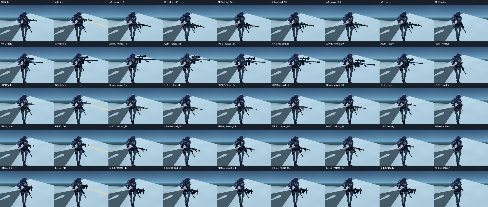
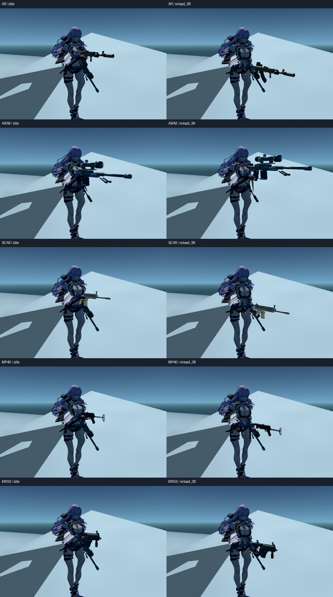

# Aurora V3 — incremento verificado y alcance pendiente

**La integración integral no está terminada. No generar APK ni fusionar como entrega completa.**

Código probado: [`c8ba54da24c9fe104672c0fbef9ca9fa2a320a24`](https://github.com/DEMIANFF/THEDEMIANFF-LAST-ZONE/commit/c8ba54da24c9fe104672c0fbef9ca9fa2a320a24), descendiente de la V75.117 probada `89408684f423ac698c45ddd39fc2b25c0ac1b4fb`. [PR draft #123](https://github.com/DEMIANFF/THEDEMIANFF-LAST-ZONE/pull/123).

## Resultado verificable

- SCAR: se corrigieron los ejes y el desfase entre malla, agarre y cañón, en mano, espalda y botín.
- AWM actual del proyecto: se corrigió la conversión Blender/glTF; tiene anclajes físicos de agarre, apoyo y boca del cañón.
- Las cinco armas actuales usan apoyo de ambos brazos en las poses revisadas de Lila. La solución conserva la longitud de los huesos, mantiene el agarre delante del torso y usa puntos de apoyo dentro de la geometría. Se libera durante recarga, curación y paracaídas.
- Entrenamiento incorpora recogidas físicas de SCAR, MP40, KRISS y munición AR/SMG, con disparo, inventario y recarga reales. Iniciar BR retira esos suministros y reinicia el inventario del modo.
- La salida del editor HUD, el lobby y la secuencia BR conservan sus flujos. No se tocaron certificados, configuración Firebase productiva, IDs ni la rama estable.

La AWM de este incremento es la generada por el proyecto; **no es `awm.glb` del inventario V3**. La KRISS procede de V2. AR usa el AK74 anterior. Solo SCAR y MP40, de estas cinco armas, remiten a originales V3.

## Pruebas y evidencia

- [Suite completa correcta](https://github.com/DEMIANFF/THEDEMIANFF-LAST-ZONE/actions/runs/43976485404): **124 scripts de Godot**, cinco pruebas del recuperador, seis derivados comprobados e importación de GLB sin errores. Incluye cámara/ADS, combate, IA, avión, paracaídas, HUD, colisiones y persistencia.
- [Artefacto completo: logs, importación, capturas de armas y lobby](https://github.com/DEMIANFF/THEDEMIANFF-LAST-ZONE/actions/runs/43976485404/artifacts/14282315823), 18.503.003 bytes. SHA-256: `fd2c24b2a37acfa9f18185cd1ae29ac0eae7b1e300cd496ad7c45b288cbd97e3`. El paso `NO_INTERMEDIATE_APK` también pasó.
- [Registro de validación legible por máquina](AURORA_V3_VALIDATION.json) con los nombres de los 124 scripts.

- [Revisión específica de armas](https://github.com/DEMIANFF/THEDEMIANFF-LAST-ZONE/actions/runs/43976485523): tres pruebas de geometría/combate correctas y 45 capturas reales de Godot, revisadas visualmente.
- [PNG originales, manifiesto de poses y logs de esa revisión](https://github.com/DEMIANFF/THEDEMIANFF-LAST-ZONE/actions/runs/43976485523/artifacts/14281645015). SHA-256 del ZIP de evidencias: `a2d7feda28280a13d4e2e5b1ab6c32cc5c833acfe15eb6798e766b6fb214b048`.
- La prueba de anclajes mide las manos animadas, comprueba que los marcadores pertenecen a la malla y que el origen del disparo coincide con el cañón visible. La separación del apoyo en las poses automatizadas quedó por debajo de 1 mm; esto es una medida de huesos/anclajes, no una certificación de contacto de cada dedo.
- Los PNG se generaron con Godot 4.7.2 en escritorio, `gl_compatibility`, a 960×640. El proyecto Android conserva Mobile/Vulkan. **No hay prueba física nueva en Motorola, ni medición de FPS/VRAM Android.**
- Las imágenes muestrean reposo, disparo, cinco fases de recarga, retorno y arma guardada. No validan por sí solas todos los ángulos de cámara ni la continuidad completa de las transiciones.
- En AR y KRISS, la instantánea llamada `ready` se tomó justo después de vaciar el temporizador de recarga mientras la mezcla de animación aún liberaba el apoyo. Ese fotograma no se presenta como prueba de retorno completo; la continuidad de esa transición y el contacto fino de dedos permanecen pendientes.

### Capturas posteriores al ajuste

El [informe de hallazgos](AURORA_V3_VISUAL_FINDINGS.md) conserva la captura anterior. Las 123 pruebas de aquel incremento pasaron, pero sus renders revelaron la SCAR desplazada y la AWM invertida; por eso no se aceptó aquel resultado como terminado.

## Matriz de cierre

| Bloque | Estado | Evidencia / límite |
|---|---|---|
| Base V75.117 y rama aislada | HECHO | 199 ramas revisadas inicialmente; base y estable permanecen en sus SHA anteriores. |
| Documentación y matriz de 80 originales | HECHO | Se leyeron inventario, maestro, licencias, audio, reconstrucción y adendas. [Matriz individual](aurora-v3/INTEGRATION_MATRIX.md). |
| Seis derivados V3 ya existentes | HECHO: importación/procedencia grabada | Ocho filas del inventario por los duplicados. No son 80 originales recuperados ni hashes fuente recalculados. |
| Entrenamiento con SCAR/MP40/KRISS y munición | HECHO en Godot | Recogida automática, daño físico, recarga, inventario y aislamiento de BR. |
| Anclajes/orientación y apoyo de cinco armas actuales | HECHO en poses revisadas | Originales, dedos, transiciones completas, todos los ángulos y masculino siguen pendientes. |
| Reconstruir 24 ZIP y recalcular 80 SHA | BLOQUEADO | No hay entorno local para transferir, descomprimir y leer los bytes privados. **0 originales con SHA-256 recalculado en esta sesión.** |
| Recuperar sonidos y adendas completas | BLOQUEADO | Los cargadores/eventos existentes no prueban que los audios entregados estén incorporados. |
| Clips originales y retarget a ambos operadores | PENDIENTE | SCAR actual sigue sin sus cuatro clips FPS. El apoyo programado no sustituye ese retarget. |
| Todas las familias, vehículos, mapas, protección, consumibles, emotes y cosméticos | PENDIENTE | Requieren originales, permisos y lógica/validación específica. No se presentan como implementados por estar inventariados. |
| Licencias pendientes o incompatibles | BLOQUEADO para distribución prevista | No se añadieron nuevos binarios de terceros. Los casos NC/ND/Standard y derechos adicionales conservan sus bloqueos. |
| Prueba física y rendimiento Motorola | PENDIENTE | No hay evidencia de ejecución en el dispositivo para este incremento. |
| APK integral | BLOQUEADO | El encargo exige completar y validar el bloque integral antes de generarla. No se produjo APK intermedia. |

## Continuidad

Los originales no se eliminaron ni sobrescribieron. El repositorio conserva el script de reconstrucción entregado y un recuperador que verifica las 24 partes, extracción segura, duplicados, tamaños y SHA antes de publicar un destino nuevo. Las cinco pruebas del recuperador usan muestras sintéticas; no equivalen a ejecutar los ZIP reales.

La siguiente dependencia es recuperar los bytes de Biblioteca en un entorno operativo. [Recuperación, adendas y límites](aurora-v3/RECOVERY_AND_STATUS.md). Los 80 registros conservan el SHA esperado y el valor actual nulo mientras esa verificación no exista.

Cualquier commit posterior que solo adjunte estas imágenes y actualice la matriz/documentación debe distinguirse del SHA del código probado indicado al inicio.
