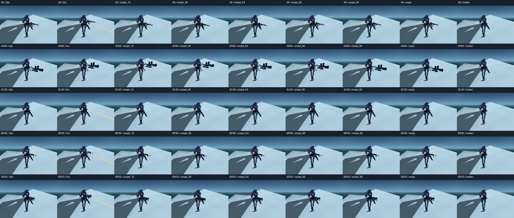

# Aurora V3: anomalías observadas y corrección del incremento

El commit `da28dcc6fbc3699c26d4c15bddefcf49b019df3e` pasó 123 scripts de QA de Godot y cinco pruebas del recuperador. [CI](https://github.com/DEMIANFF/THEDEMIANFF-LAST-ZONE/actions/runs/43970208313). La revisión de sus 45 capturas detectó problemas visuales que esa suite no comprobaba.

## SCAR

Se leyó el binario `aurora_scar.glb` ya presente en GitHub. Sus accesores POSITION sitúan la malla en Y de -1.739748 a -0.786402 y Z de 1.632327 a 1.889062, con el eje longitudinal en Y. En cambio, los marcadores Grip/Muzzle del derivado describían otro origen: Grip=(0,0,0), Muzzle≈(0.000268,0.08308,-0.62239). Por tanto, una prueba de longitud podía pasar aunque el arma quedara separada de las manos y el disparo saliera de un punto ajeno al cañón.

La corrección aplica a la malla existente un giro de -90° en X y traslación (0,-1.72,-1.49), calibra Grip/Muzzle sobre esa geometría y añade un punto de apoyo. Se aplica tanto al arma en mano como a su instancia en espalda. No se modifican los originales privados, ni se afirma recuperar sus cuatro clips FPS.

## AWM

El constructor describe las piezas en coordenadas de juego (+Y arriba, -Z hacia delante), pero las exportaba como coordenadas Blender (+Z arriba). La inferencia posterior de eje longitudinal giraba el rifle en el sentido contrario. El constructor ahora convierte explícitamente el marco de juego antes de exportar, y conserva marcadores de agarre, apoyo, boca y óptica. El montaje usa Grip y el rayo físico usa el Muzzle real.

## Alcance de la comprobación

La nueva prueba exige agarre a menos de 8 cm de la mano derecha, marcadores dentro de los límites geométricos, cañón orientado hacia delante y por encima del agarre, y coincidencia del origen del disparo con Muzzle. El error de la mano de apoyo se registra como medida; no se da por corregido el agarre de dos manos ni el retarget masculino sin aceptación visual.

Los renders siguientes deben revisarse antes de aceptar la corrección. No se ha probado este incremento en un Motorola físico y no se genera APK.
